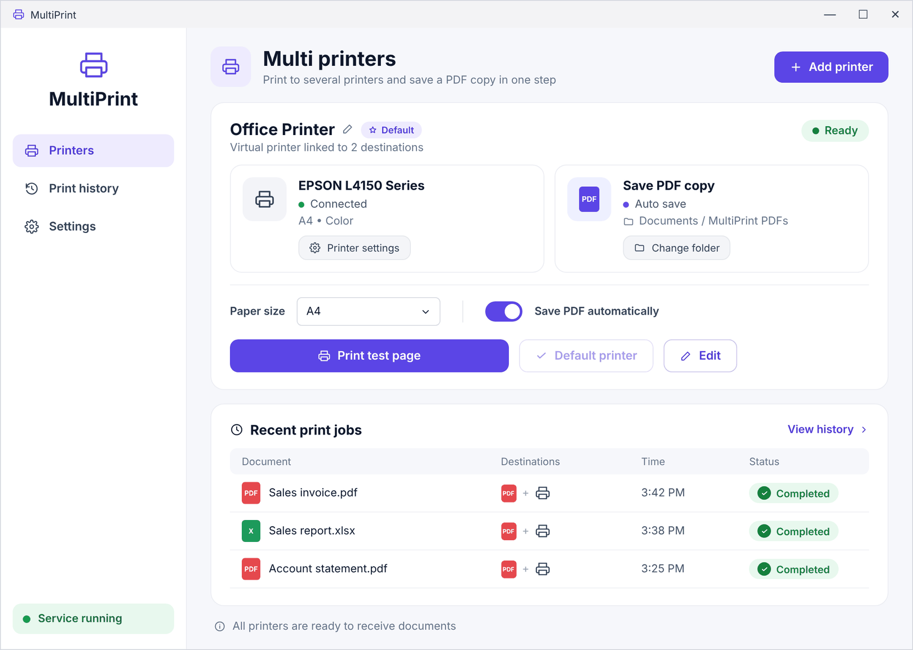

# DualPrint

**Print to all your printers at once, and save a PDF copy automatically.**

DualPrint adds a single virtual printer to Windows. When you print to it from any application, such as Word, Excel, your browser or an accounting system, the document is sent to all the selected printers at the same moment, and a PDF copy can be saved to a fixed folder without any save dialog.

> 🌐 **Official website:** the link is in the *About* box at the top of this page. The site is available in Arabic, English, Russian, German, Spanish and French.



DualPrint 3.0.0 is the new name for MultiPrint. It works with two or more printers. Existing printers, settings, language, history and PDF folders are kept on upgrade. See the [3.0.0 release notes](docs/release-notes/v3.0.0.md) before upgrading.

## Download

Download the latest version from the [Releases](../../releases/latest) page, extract `DualPrint.zip`, run `DualPrint.exe`, and approve the administrator prompt.

> On first run, Windows may show the message "Windows protected your PC" because the file is not digitally signed yet. If so, choose **More info**, then **Run anyway**.

## Features

- A virtual printer linked to one or more of the printers installed on the computer, with an optional PDF copy.
- Automatic saving of PDF files to a fixed folder, with a custom file-name prefix (for example `Invoice_2026-11-02_15-45-00.pdf`).
- Multiple multi-printers, each with its own printers, folder and settings.
- Paper size per multi-printer: A4, A3, A5, Letter, Legal or Automatic.
- A print history showing each document's name, destinations, print time and result.
- Print a test page, open any printer's settings, and set a multi-printer as the default printer.
- A background service that starts with Windows and recovers automatically, so the app does not need to stay open.
- A user interface in five languages: Arabic, English, Spanish, French and German.

## Quick start

1. Run the app and choose a language (first run only).
2. Choose **Add printer**, enter a name and select the printers. If you add PDF, choose the save folder, then click **Save**.
3. Print from any application and select the new printer by its name.

Full details are in the [User Guide](docs/USER_GUIDE.md).

## Documentation

| File | Contents |
|---|---|
| [docs/USER_GUIDE.md](docs/USER_GUIDE.md) | User guide |
| [docs/ARCHITECTURE.md](docs/ARCHITECTURE.md) | Technical architecture and how it works |
| [docs/BUILDING.md](docs/BUILDING.md) | Building the app from source |
| [docs/PUBLISHING.md](docs/PUBLISHING.md) | Publishing on GitHub, releasing versions and appearing in search engines |
| [docs/TROUBLESHOOTING.md](docs/TROUBLESHOOTING.md) | Solving common problems |
| [SECURITY.md](SECURITY.md) | Security policy and vulnerability reporting |
| [CHANGELOG.md](CHANGELOG.md) | Release history |

## Project structure

```
dualprint/
├─ src/
│  ├─ DualPrint.ps1      ← the app (UI and print service)
│  ├─ strings.json        ← texts for the five languages
│  └─ Launcher.cs         ← the executable that runs the app
├─ assets/icon.ico        ← app icon
├─ build.ps1              ← builds build/DualPrint.exe
├─ website/               ← official website (GitHub Pages)
├─ tools/                 ← website texts and the site generator
├─ docs/                  ← documentation
└─ .github/workflows/     ← automated build and publishing
```

## Building from source

On Windows, with no extra tools to install (the build uses the `csc.exe` compiler that ships with the built-in .NET Framework):

```powershell
powershell -ExecutionPolicy Bypass -File .\build.ps1 -Version 3.0.0
```

This creates `build\DualPrint.exe`. See [docs/BUILDING.md](docs/BUILDING.md) for details.

## Tests and configuration

From the repository root on Windows, run the existing Pester suite:

```powershell
powershell -NoProfile -ExecutionPolicy Bypass -Command "Invoke-Pester -EnableExit"
```

No application environment variables or `.env` configuration are required. See [Building](docs/BUILDING.md) for packaging verification and test limits.

## License

The app is distributed under the [MIT](LICENSE) license. To print documents on physical printers, the app downloads [SumatraPDF](https://www.sumatrapdfreader.org) (GPLv3 license) when needed; the tool is not bundled with the project.

---

<sub>**Keywords:** print to multiple printers at once · print to two printers simultaneously · connect two printers · virtual printer · auto save PDF when printing · duplicate print job · الطباعة على أكثر من طابعة · ربط طابعتين · طابعة افتراضية · حفظ PDF تلقائي · печать на несколько принтеров одновременно · виртуальный принтер · auf mehreren Druckern gleichzeitig drucken · virtueller Drucker · imprimir en varias impresoras · imprimer sur plusieurs imprimantes</sub>
