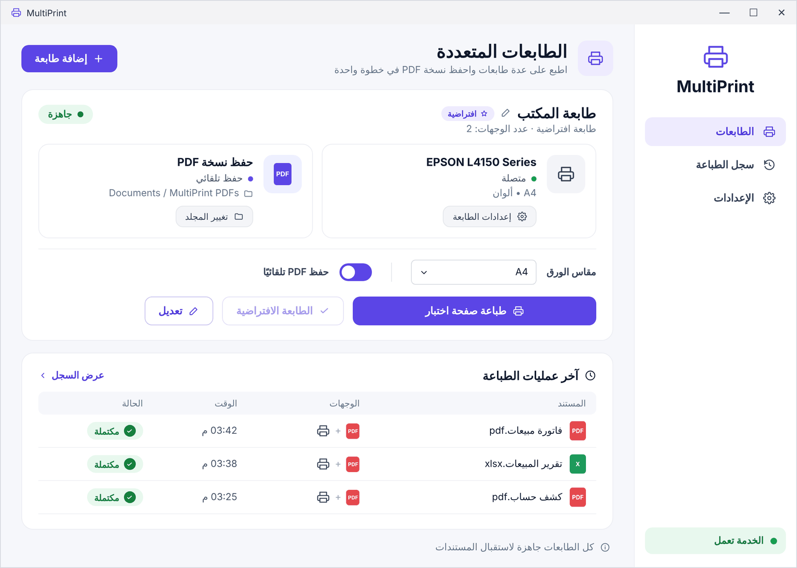

<div dir="rtl">

# MultiPrint

**اطبع على جميع طابعاتك في آنٍ واحد، مع حفظ نسخة PDF تلقائيًا.**

يضيف MultiPrint إلى نظام Windows طابعة افتراضية واحدة. عند الطباعة عليها من أي تطبيق، مثل Word أو Excel أو المتصفح أو الأنظمة المحاسبية، يُرسَل المستند إلى جميع الطابعات المحددة في اللحظة نفسها، ويمكن حفظ نسخة PDF منه في مجلد ثابت دون أي نافذة حفظ.

> 🌐 **الموقع الرسمي:** يتوفر رابطه في خانة *About* أعلى هذه الصفحة، وهو متاح باللغات العربية والإنجليزية والروسية والألمانية والإسبانية والفرنسية.



## التنزيل

نزّل أحدث إصدار من صفحة [Releases](../../releases/latest)، ثم فكّ ضغط الملف `MultiPrint.zip` وشغّل `MultiPrint.exe`.

> قد يعرض Windows عند التشغيل الأول رسالة «Windows protected your PC» لأن الملف غير موقّع رقميًا بعد. في هذه الحالة اختر **More info** ثم **Run anyway**.

## المزايا

- طابعة افتراضية مرتبطة بطابعة واحدة أو أكثر من الطابعات المثبتة على الجهاز، مع إمكانية إضافة نسخة PDF.
- حفظ تلقائي لملفات PDF في مجلد ثابت، مع إمكانية تحديد بداية اسم الملف (مثل `فاتورة_2026-11-02_15-45-00.pdf`).
- إنشاء أكثر من طابعة متعددة، لكلٍّ منها طابعاتها ومجلدها وإعداداتها.
- تحديد مقاس الورق لكل طابعة متعددة: A4 أو A3 أو A5 أو Letter أو Legal أو تلقائي.
- سجل للطباعة يوضح اسم المستند ووجهاته ووقت طباعته ونتيجتها.
- طباعة صفحة اختبار، والوصول إلى إعدادات أي طابعة، وتعيين الطابعة المتعددة طابعةً افتراضية.
- خدمة تعمل في الخلفية مع بدء تشغيل Windows وتستعيد عملها تلقائيًا، فلا يلزم إبقاء البرنامج مفتوحًا.
- واجهة بخمس لغات: العربية والإنجليزية والإسبانية والفرنسية والألمانية.

## البدء السريع

1. شغّل البرنامج واختر اللغة (عند التشغيل الأول فقط).
2. اختر **إضافة طابعة**، ثم أدخل اسمًا وحدّد الطابعات. وإذا أضفت PDF فاختر مجلد الحفظ، ثم اضغط **حفظ**.
3. اطبع من أي تطبيق واختر الطابعة الجديدة باسمها.

التفاصيل الكاملة في [دليل الاستخدام](docs/USER_GUIDE.md).

## التوثيق

| الملف | المحتوى |
|---|---|
| [docs/USER_GUIDE.md](docs/USER_GUIDE.md) | دليل الاستخدام |
| [docs/ARCHITECTURE.md](docs/ARCHITECTURE.md) | البنية التقنية وآلية العمل |
| [docs/BUILDING.md](docs/BUILDING.md) | بناء البرنامج من الشيفرة المصدرية |
| [docs/PUBLISHING.md](docs/PUBLISHING.md) | النشر على GitHub وإصدار النسخ والظهور في محركات البحث |
| [docs/TROUBLESHOOTING.md](docs/TROUBLESHOOTING.md) | حل المشكلات الشائعة |
| [SECURITY.md](SECURITY.md) | سياسة الأمان والإبلاغ عن الثغرات |
| [CHANGELOG.md](CHANGELOG.md) | سجل الإصدارات |

## هيكل المشروع

```
multiprint/
├─ src/
│  ├─ MultiPrint.ps1      ← البرنامج (الواجهة وخدمة الطباعة)
│  ├─ strings.json        ← نصوص اللغات الخمس
│  └─ Launcher.cs         ← الملف التنفيذي الذي يشغّل البرنامج
├─ assets/icon.ico        ← أيقونة البرنامج
├─ build.ps1              ← يبني build/MultiPrint.exe
├─ website/               ← الموقع الرسمي (GitHub Pages)
├─ tools/                 ← نصوص الموقع وأداة توليده
├─ docs/                  ← التوثيق
└─ .github/workflows/     ← البناء والنشر التلقائي
```

## البناء من الشيفرة المصدرية

على نظام Windows، ودون الحاجة إلى تثبيت أي أدوات إضافية:

```powershell
powershell -ExecutionPolicy Bypass -File .\build.ps1 -Version 2.2.5
```

يُنشأ الملف `build\MultiPrint.exe`. راجع [docs/BUILDING.md](docs/BUILDING.md) للتفاصيل.

## الترخيص

يُوزَّع البرنامج بموجب ترخيص [MIT](LICENSE). ولطباعة المستندات على الطابعات الفعلية، ينزّل البرنامج أداة [SumatraPDF](https://www.sumatrapdfreader.org) (ترخيص GPLv3) عند الحاجة، ولا تُضمَّن الأداة داخل المشروع.

</div>

---

## English


**MultiPrint** adds a virtual printer to Windows that sends every print job to one or more printers at once, and can save a PDF copy to a fixed folder automatically.

- **Download:** [latest release](../../releases/latest) → `MultiPrint.zip` → run `MultiPrint.exe` (approve the administrator prompt).
- **Features:** multiple multi-printers, paper size per printer, automatic PDF with a custom file-name prefix, print history, test page, set as default printer, a background service that starts with Windows, and a UI in Arabic, English, Spanish, French and German.
- **Build:** `powershell -ExecutionPolicy Bypass -File .\build.ps1 -Version 2.2.5` on Windows (uses the built-in .NET Framework `csc.exe`).
- **License:** MIT. SumatraPDF (GPLv3) is downloaded at runtime and is not bundled.

<sub>**Keywords:** print to multiple printers at once · print to two printers simultaneously · connect two printers · virtual printer · auto save PDF when printing · duplicate print job · الطباعة على أكثر من طابعة · ربط طابعتين · طابعة افتراضية · حفظ PDF تلقائي · печать на несколько принтеров одновременно · виртуальный принтер · auf mehreren Druckern gleichzeitig drucken · virtueller Drucker · imprimir en varias impresoras · imprimer sur plusieurs imprimantes</sub>
